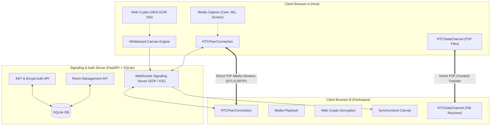

# NexusMeet — Real-Time Video Conferencing & Collaboration Platform

**NexusMeet** is a modern, high-performance real-time video conferencing and collaborative workspace. Built with **WebRTC**, **FastAPI**, **WebSockets**, and the **Web Crypto API (AES-GCM 256-bit)**, it provides seamless multi-user audio/video calls, screen sharing, real-time synchronized whiteboard, P2P encrypted file sharing, and in-room chat.

---

## 🌟 Core Features

- **📹 Multi-User Video Calling**: P2P Mesh WebRTC connection (`RTCPeerConnection`) with automatic SDP offer/answer negotiation, ICE trickle with STUN servers, active speaker detection, and responsive video grid.
- **🖥️ Screen Sharing**: One-click screen capture (`getDisplayMedia`) with dynamic track replacement across all active peer streams.
- **🎨 Collaborative Whiteboard**: Real-time canvas with high-DPI scaling, smooth freehand brush, highlighter, straight lines, arrows, rectangles, circles, text tool, undo/redo, clear board, live collaborative cursor pointers, and PNG image export.
- **📁 P2P Encrypted File Sharing**: High-speed chunked binary data transfer over WebRTC `RTCDataChannel` with real-time transfer progress bars and instant file download.
- **🔒 End-to-End Encryption (E2EE)**:
  - **Media**: All audio and video streams are encrypted end-to-end with **DTLS-SRTP** (mandated by the WebRTC standard).
  - **Data/Chat/Whiteboard**: End-to-end encrypted in the browser using the **Web Crypto API** (**AES-GCM 256-bit**) with room-derived keys (**PBKDF2** with SHA-256 and 100,000 iterations).
- **🛡️ Secure User Authentication & Room Management**:
  - User signup and login with **bcrypt** password hashing and **JWT** (JSON Web Tokens).
  - Instant guest access (one-click meeting join without account).
  - Password-protected rooms with passcode verification.
  - Shareable meeting links with one-click copy.
  - Host controls: Mute participants, kick participants, lock room.

---

## 🏗️ System Architecture



---

## 🚀 Quick Start Guide

### 1. Requirements
- Python 3.10+ (Python 3.14 compatible)
- Modern web browser (Chrome, Edge, Firefox, Safari, Brave)

### 2. Launch the Application
Run the launcher script:
```powershell
python run.py
```
This automatically initializes the SQLite database, starts the Uvicorn server on `http://127.0.0.1:8000`, and opens your default browser!

Alternatively, you can run directly with Uvicorn:
```powershell
python -m uvicorn server.main:app --host 127.0.0.1 --port 8000 --reload
```

---

## 🧪 Testing Multi-User Calling Locally

1. Launch the app (`python run.py`).
2. On the home page, enter a meeting topic and click **"Create New Meeting"**.
3. Allow camera/microphone access in your browser.
4. Copy the meeting URL or Room ID.
5. Open a **second browser window** (e.g. an **Incognito / Private tab** or a different browser like Chrome / Edge / Firefox).
6. Paste the meeting URL to join the room.
7. Both video tiles will connect in P2P mesh, and you can test:
   - 🎤 **Mute / Unmute** and **Camera Toggle**
   - 🖥️ **Screen Sharing**
   - 🎨 **Whiteboard**: Open the whiteboard and draw — strokes appear simultaneously with live cursor tracking on both windows!
   - 💬 **Encrypted Chat**: Send messages and see the `🔒 E2EE Active` encryption in action.
   - 📁 **File Sharing**: Drop any file in the files drawer to watch the real-time chunked transfer.

---

## 📂 Project Structure

```
communication-app/
│
├── server/
│   ├── __init__.py
│   ├── main.py              # FastAPI app, API endpoints, WebSocket signaling, static mounting
│   ├── auth.py              # Password hashing (bcrypt) and JWT token generation
│   ├── config.py            # JWT secret, SQLite path, and STUN ice servers
│   ├── database.py          # Asynchronous SQLite DB init and connection
│   ├── models.py            # Database schema definitions
│   └── signaling.py         # WebRTC Signaling manager (SDP exchange, ICE candidates, rooms)
│
├── client/
│   ├── index.html           # Landing page with room creation, join, and user auth
│   ├── room.html            # Video conferencing & collaboration workspace
│   ├── css/
│   │   ├── style.css        # Dark mode design system, video grid, and responsive layout
│   │   └── whiteboard.css   # Whiteboard floating toolbar, canvas viewport, and swatches
│   └── js/
│       ├── auth.js          # Authentication state, login/register API calls, guest tokens
│       ├── crypto.js        # Web Crypto API AES-GCM 256-bit E2EE implementation
│       ├── webrtc.js        # WebRTC mesh peer connection, tracks, and audio meter
│       ├── whiteboard.js    # Canvas engine with tools, undo/redo, and collaborative cursors
│       ├── fileshare.js     # DataChannel binary chunked file transfer with progress
│       ├── chat.js          # Encrypted in-meeting chat manager
│       └── app.js           # Conference room coordinator and UI event handlers
│
├── data/
│   └── app.db               # SQLite database (auto-generated)
├── requirements.txt         # Project dependencies
├── run.py                   # One-click application launcher
└── README.md                # Documentation and architecture breakdown
```

---

## 🔒 Security Architecture

1. **Media Security**: WebRTC requires DTLS (Datagram Transport Layer Security) and SRTP (Secure Real-time Transport Protocol) for all peer-to-peer audio and video transmission.
2. **End-to-End Chat & Whiteboard Encryption**: All messages and whiteboard strokes are encrypted locally in the browser with AES-GCM 256-bit using the Web Crypto API before leaving the client. The server cannot inspect the plaintext payload.
3. **Password Security**: Passwords are never stored in plaintext; they are hashed using `bcrypt` with salt.
4. **Token Security**: Session authorization uses stateless HMAC-SHA256 JWT tokens.
